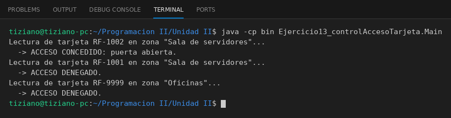

# ControladorDeAcceso

Programación II - Unidad 2 - Ejercicio 13

## Consigna
Un lector de tarjetas consulta a un controlador si una tarjeta puede ingresar a una zona.

## Lógica
- `TarjetaRFID`: código único y nivel de acceso.
- `ControladorDeAcceso`: base interna con las tarjetas registradas y el nivel requerido por zona; `verificarAcceso(tarjeta, zona)` retorna `true` si la tarjeta está registrada y su nivel alcanza.
- `LectorTarjetas`: asociado al controlador; `acercarTarjeta` envía las credenciales e imprime acceso concedido o denegado.
- `Main`: tarjeta válida, de nivel insuficiente y no registrada.

## Ejecución

